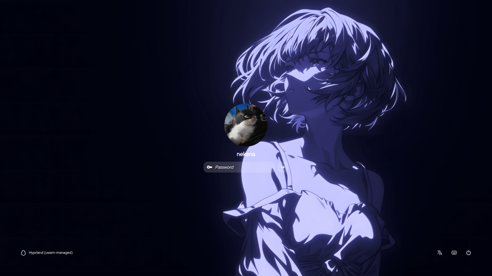
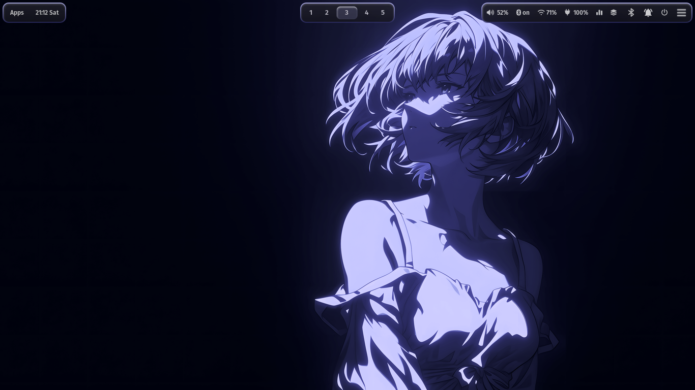
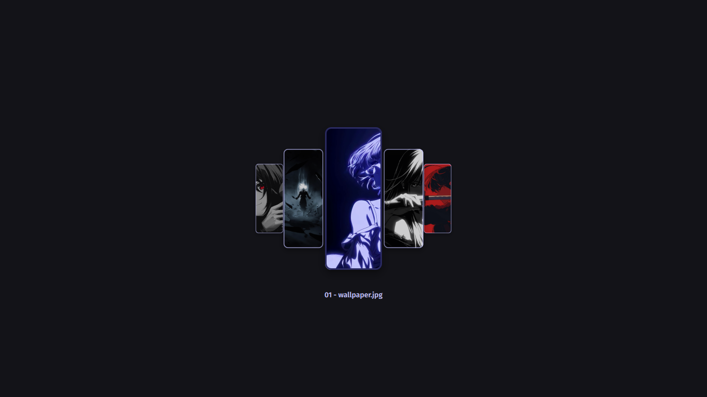
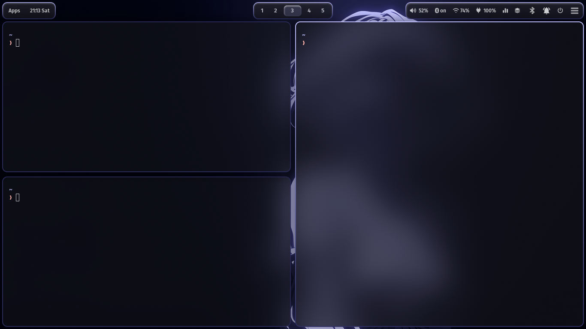

# My Arch Linux

> Too lazy to set everything up again whenever something breaks, so I keep it here :D

This repo contains my minimal Arch Linux setup: the tools I use and my desktop config.

## Screenshots









## Software

- **Desktop:** Hyprland, Waybar, Quickshell, Hyprlock, SDDM
- **Editors & IDEs:** IntelliJ IDEA, Visual Studio Code, Neovim, Arduino IDE
- **Languages:** Java, Python, JavaScript, TypeScript, C, C++
- **Development tools:** Maven, uv, Node.js, npm, GCC, CMake, Git
- **Game development:** Godot
- **Virtualization:** VirtualBox
- **Database:** PostgreSQL
- **Applications:** Firefox, VLC, Thunar, imv, Zathura, File Roller, 7-Zip

## Installation

```bash
sudo pacman -S --needed git
git clone https://github.com/andriniainanekena/my-arch.git
cd my-arch
bash install.sh
```
